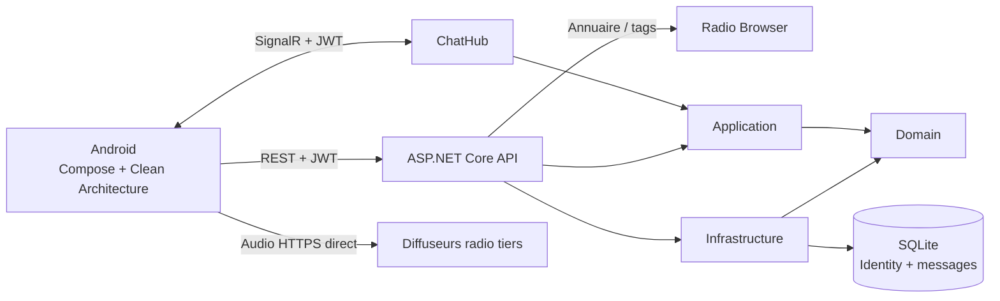

# Architecture Tunetalk

## Vue d’ensemble

Le serveur n’est jamais un proxy audio. Le mobile reçoit l’URL HTTPS d’une station et ouvre cette URL dans un lecteur Media3/MediaSession. L’API conserve les comptes et l’historique du chat, pas les contenus musicaux.

## Android

Les sources sont rangées par responsabilité dans `app/src/main/java/malo/mrn/tunetalk` :

- `domain/model`, `domain/repository`, `domain/usecase`, `domain/validation` : modèles et règles indépendants du framework.
- `data/remote`, `data/local`, `data/repository` : Retrofit, SignalR, DataStore et implémentations des contrats.
- `presentation` : état d’écran, ViewModel et composants Jetpack Compose.
- `di` : composition manuelle des dépendances ; Hilt/Koin n’est pas nécessaire pour ce MVP.
- `playback` : service Media3 avec MediaSession pour continuer l’écoute en arrière-plan.

Le jeton d’accès est stocké dans le DataStore privé de l’application et expire après 60 minutes. Les sauvegardes Android sont désactivées pour éviter de restaurer le jeton sur un autre appareil.

## API

`Api` dépend des contrats Application et assemble les adaptateurs Infrastructure. `Application` dépend uniquement du Domain. `Infrastructure` implémente les ports de persistance, d’identité et de catalogue.

### Authentification

ASP.NET Identity stocke les utilisateurs et hache les mots de passe. Les endpoints d’inscription/connexion délivrent un JWT HMAC-SHA256 ; l’API valide signature, émetteur, audience et expiration. La clé de signature (au moins 32 octets UTF-8) vient de `dotnet user-secrets` en local ou d’un secret d’environnement en déploiement. Elle n’est pas versionnée.

### Catalogue radio

`IRadioChannelCatalog` ne permet que les genres prédéfinis du serveur. L’adaptateur résout le pool documenté `all.api.radio-browser.info`, effectue des requêtes HTTPS avec un User-Agent identifiable et essaie les serveurs disponibles. Les résultats sont mis en cache cinq minutes ; une indisponibilité externe retourne HTTP 503, pas une liste fictive.

Seules les URL de flux et d’illustration en HTTPS sont transmises. Si une station ne fournit qu’un flux HTTP, elle peut être visible mais l’application ne la lira pas. Les identifiants persistants sont les `stationuuid`, pas les anciens champs `id`.

### Chat et présence

Le hub authentifié accepte une seule chaîne par connexion, vérifie son UUID auprès du catalogue, limite les messages à 500 caractères et à cinq messages par compte toutes les dix secondes, puis prend le pseudo depuis les claims JWT. Les messages sont enregistrés en SQLite avant leur diffusion au groupe SignalR. L’historique REST renvoie les 50 derniers messages.

Le compteur affiché correspond aux connexions actives sur l’instance de l’API, pas à une mesure fournie par le diffuseur ni nécessairement au nombre de personnes uniques. Les limites et présences sont locales à l’instance et repartent à zéro après redémarrage ; une production multi-instance doit ajouter un backplane/limiteur distribué.

## API mobile

La base URL Android est fournie via `TUNETALK_API_BASE_URL` ou la propriété Gradle `tunetalkApiBaseUrl`. Le défaut `http://10.0.2.2:5269/` est réservé à l’émulateur et au build Debug ; le manifeste Release n’autorise pas le trafic HTTP clair. Pour un appareil physique, le serveur de développement doit écouter sur son interface LAN et le pare-feu doit autoriser le port choisi.

## Charte graphique

- Fond nuit `#0B0C12`, surfaces `#151722` / `#202331`.
- Violet électrique `#9B7BFF` pour l’action principale ; menthe `#5FE1C0` pour le direct et les accents ; corail `#FF8F82` pour les erreurs.
- Thème sombre fixe, cartes à grands arrondis et typographie sans sérif fournie par Android.
- Ton éditorial français, courts libellés, états d’erreur visibles et états de chargement explicites.

## Sources et limites de licence

- Radio Browser, documentation de l’API : <https://api.radio-browser.info/>
- Live365, fonctionnalités et couverture de licences annoncée : <https://www.live365.com/broadcaster/radio-broadcasting>
- Radio.co, gestion et distribution de stations : <https://www.radio.co/>
- Microsoft, client Java SignalR et authentification par bearer token : <https://learn.microsoft.com/aspnet/core/signalr/java-client>

Radio Browser répertorie des diffuseurs ; cela ne confère aucun droit de retransmission à Tunetalk. Tout lancement public/commercial requiert une validation juridique des licences et des conditions de chaque diffuseur.
